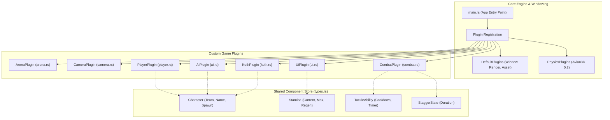

# Cyber-Athletic Coliseum: 3v3 Tactical Yard

A fast-paced, 3D physics-driven **Tactical King of the Hill / Capture Brawler** built entirely in **Rust**, compiled to **WebAssembly (Wasm)**, and rendered via **WebGL2 / WebGPU** in modern web browsers.

Styled directly after the comic/cel-shaded tactical training compound aesthetic featuring recognizable operators (**Anders**, **Morten**, **Siri**, **Lisa**).

---

## Table of Contents
1. [Overview & Game Concept](#overview--game-concept)
2. [Art Style & Visual Direction](#art-style--visual-direction)
3. [Technology Stack](#technology-stack)
4. [Architecture & Component Breakdown](#architecture--component-breakdown)
5. [The Build & Packaging Pipeline](#the-build--packaging-pipeline)
6. [How to Run & Develop](#how-to-run--develop)
7. [Controls & Gameplay Rules](#controls--gameplay-rules)
8. [Project Structure](#project-structure)

---

## Overview & Game Concept

*Cyber-Athletic Coliseum* places you in a tactical training yard where two teams of operators clash over key flag pedestals and capture zones:

- **Match Format**: **3v3 Team Match**
  - **Team Blå (Allies)**: Player (*Anders [Blå]*) + 2 AI Teammates (*Morten [Blå]*, *Jonas [Blå]*)
  - **Team Rød (Opponents)**: 3 AI Bots (*Siri [Rød]*, *Lisa [Rød]*, *Per [Rød]*)
- **Objective**: Capture and hold elevated flag pedestals to score points. The first team to reach **100 points** secures victory.
- **Combat Style**: Physics-based kinetic tackles, shoves, and spatial displacement. Shoving opponents off platforms halts their scoring and interrupts their offensive pushes.

---

## Art Style & Visual Direction

The visual style is inspired by modern cel-shaded / comic-style tactical esports:
- **Crisp Daytime Lighting**: Sunny outdoor compound lighting with bright directional sunlight and clear blue sky.
- **Stylized Operators**:
  - **Anders [Blå]**: Navy tactical jumpsuit, plate carrier, black rectangular glasses frame, stubble, and radio headset.
  - **Morten [Blå]**: Navy tactical jumpsuit, full facial beard, and headset.
  - **Siri [Rød]**: Crimson tactical jumpsuit, ponytail, plate carrier, and headset.
  - **Lisa [Rød]**: Crimson tactical jumpsuit, blonde ponytail, and headset.
- **Underfoot Ground Rings**: Glowing team-colored selection rings under every operator (Cyan/Blue for Blå, Crimson Red for Rød).
- **Floating Overhead Nametags & Vitals**: Real-time 3D nameplates over heads with health and stamina indicators.
- **Tactical Compound Layout**: Red and blue cargo shipping containers, concrete jersey barriers, sandbag walls, green hedge bushes, oil drums, and chain-link perimeter fences.

---

## Technology Stack

| Layer | Technology | Version | Purpose |
| :--- | :--- | :--- | :--- |
| **Language** | [Rust](https://www.rust-lang.org/) | 1.80+ (Edition 2021) | Memory safety, performance, and cross-platform compilation |
| **Game Engine** | [Bevy Engine](https://bevyengine.org/) | `0.15.3` | Data-driven Entity Component System (ECS), PBR rendering pipeline, UI, and windowing |
| **3D Physics Engine**| [Avian3D](https://github.com/Jondolf/avian) | `0.2.1` | Native Rust ECS physics, rigid bodies, colliders, and impulses |
| **Compilation Target**| WebAssembly (`wasm32-unknown-unknown`) | — | High-performance client-side code execution directly in the browser |
| **Graphics API** | WebGL2 / WebGPU | — | Cross-browser hardware-accelerated 3D rendering with fallback compatibility |
| **Wasm Bundler** | [Trunk](https://trunkrs.dev/) | `0.22.0` | Asset pipeline, Wasm packaging, HTML embedding, and live hot-reloading dev server |
| **Execution Env** | WSL 2 (Ubuntu 24.04 ext4) | — | Eliminates 9P filesystem bridge overhead, yielding ~20x faster builds and instant file watching |

---

## Architecture & Component Breakdown



---

## The Build & Packaging Pipeline

The game is written in Rust and targets WebAssembly (`wasm32-unknown-unknown`) using [Trunk](https://trunkrs.dev/) as the build tool and asset bundler.

### 1. Prerequisites
- **Rust Toolchain (1.80+)**: Installed via `rustup`.
- **Wasm Target**:
  ```bash
  rustup target add wasm32-unknown-unknown
  ```
- **Trunk Bundler**:
  ```bash
  cargo install trunk
  ```

### 2. Compilation Stages
1. **Rust to Wasm (`cargo build --target wasm32-unknown-unknown`)**:
   - Compiled using the profile settings in `Cargo.toml`.
   - In development (`[profile.dev]`), package dependencies are built at `opt-level = 3` for playable physics and 3D rendering speeds, while workspace code builds at `opt-level = 1` for fast turnarounds.
   - For release builds (`[profile.release]`), `opt-level = "s"` and `lto = "thin"` minimize binary download sizes.
2. **JavaScript Bindings (`wasm-bindgen`)**:
   - Trunk runs `wasm-bindgen` to generate JavaScript glue code linking browser APIs (Canvas, WebGL2, Audio, DOM events) to the Rust Wasm binary.
3. **Asset & HTML Bundling**:
   - Trunk parses `index.html`, injects the generated Wasm loader scripts, pulls in all game assets from `assets/` (glTF models, textures, audio), and writes the distribution output to the `dist/` directory.

### 3. WSL 2 Filesystem Optimization
- Compiling Bevy Wasm directly on the Windows NTFS filesystem through the 9P bridge can be slow and trigger file-lock issues.
- The repository is mirrored to the native WSL 2 ext4 filesystem (`~/repos/cyber_coliseum_koth`) using an isolated `CARGO_TARGET_DIR=~/cargo_target`, achieving rapid incremental builds (~20x faster) and reliable file-watching.

---

## How to Run & Develop

### 1. Syncing Files from Windows to WSL
If you edit code or assets in the Windows workspace (`C:\Users\ErlendHeggelund\Documents\antigravity\fervent-curie`), sync them to the native WSL repository before building:

```powershell
wsl.exe -e bash -c "rsync -av --exclude='target' --exclude='dist' --exclude='.git' /mnt/c/Users/ErlendHeggelund/Documents/antigravity/fervent-curie/ ~/repos/cyber_coliseum_koth/"
```

### 2. Launching the Development Server

#### Option A: From Windows PowerShell (One-Liner)
```powershell
wsl.exe -e bash -c "source ~/.cargo/env && cd ~/repos/cyber_coliseum_koth && CARGO_TARGET_DIR=~/cargo_target trunk serve --port 8080 --address 0.0.0.0"
```

#### Option B: From an Interactive WSL (Ubuntu) Terminal
```bash
source ~/.cargo/env
cd ~/repos/cyber_coliseum_koth
CARGO_TARGET_DIR=~/cargo_target trunk serve --port 8080 --address 0.0.0.0
```

### 3. Playing the Game
Once Trunk displays `INFO ✅ success`:
- Open **[http://localhost:8080](http://localhost:8080)** (or `http://127.0.0.1:8080`) in any modern browser.
- Trunk automatically detects file modifications, recompiles changed crates, and hot-reloads the browser page.

### 4. Building for Production / Release
To produce an optimized static build in `dist/`:
```bash
cd ~/repos/cyber_coliseum_koth
trunk build --release
```

### 5. Stopping the Server
- **In an interactive terminal**: Press `Ctrl + C`.
- **From Windows PowerShell**:
  ```powershell
  wsl.exe -e bash -c "pkill -f 'trunk serve'"
  ```

---

## Controls & Gameplay Rules

### Controls
| Key / Input | Action |
| :--- | :--- |
| **V** or **Tab** | **Toggle Camera**: Switch between **Tactical Isometric** and **3rd Person Action** |
| **Scroll Wheel** | Zoom In / Out |
| **Left Click** | Lock mouse (in 3rd person action mode) |
| **Escape** | Unlock / release mouse cursor |
| **W, A, S, D** | Move character relative to camera angle |
| **Left Shift** | **`Hastighetsboost`** (Sprint speed boost, consumes stamina) |
| **Spacebar** | Jump |
| **LMB** or **F** | **`Kastbart nett / Kinetic Tackle`** (Physical knockback lunge) |

### Match Rules
- **Winning Score**: First team to **100 points** wins.
- **Zone Rotation**: Active hill shifts every **45 seconds** between the West Base, East Base, and Center Depot.
- **Contest Mechanic**: When both teams occupy the active zone simultaneously, scoring is paused and the alert banner displays **«FLAGGSONE OMKJEMPET!»**.
- **Fallout Penalty**: Getting knocked off the arena boundaries resets the player to their spawn base with a brief recovery stun.

---

## Project Structure

```text
cyber_coliseum_koth/
├── Cargo.toml                      # Crate metadata, Bevy/Avian3D dependencies, optimization profiles
├── Trunk.toml                      # Trunk bundler settings (port 8080, address 0.0.0.0, dist output)
├── index.html                      # HTML5 canvas viewport, loading overlay, and Wasm bootstrap
├── SERVER_GUIDE.md                 # Standalone reference for starting, syncing, and stopping the server
├── KEY_LESSONS_LEARNED.md          # Technical documentation on 3D decimation, sky domes & camera occlusion
│
├── src/                            # Rust game logic & ECS systems
│   ├── main.rs                     # Entry point, DefaultPlugins & PhysicsPlugins setup
│   ├── types.rs                    # Shared components, resources, states, and Team definitions
│   ├── arena.rs                    # 3D compound environment, lighting, sky dome & boundaries
│   ├── terrain_heights.rs          # Procedural elevation and compound ground contour data
│   ├── player.rs                   # Player movement, inputs, sprint stamina, and animations
│   ├── ai.rs                       # Autonomous bot behavior, zone navigation & target selection
│   ├── combat.rs                   # Kinetic tackle ability, knockbacks, and stagger states
│   ├── koth.rs                     # King of the Hill capture logic, scoring & 45s zone rotation
│   ├── camera.rs                   # Dual-mode camera (isometric & 3rd-person) with occlusion recovery
│   └── ui.rs                       # Tactical HUD, scoreboards, overhead vitals & alert banners
│
├── assets/                         # Runtime game assets served to the browser
│   ├── models/                     # glTF 3D meshes (compound arena, character models)
│   ├── audio/                      # Sound effects and voice lines (.mp3)
│   └── textures/                   # Sky panoramas and terrain textures
│
└── dist/                           # Generated output from Trunk (Wasm binary, JS glue, bundled assets)
```
