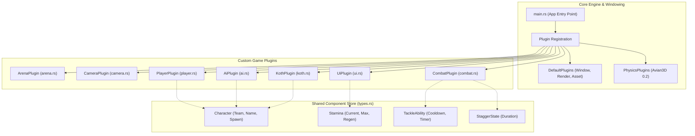

# Cyber-Athletic Coliseum: 3v3 Tactical Yard

A fast-paced, 3D physics-driven **Tactical King of the Hill / Capture Brawler** built entirely in **Rust**, compiled to **WebAssembly (Wasm)**, and rendered via **WebGL2 / WebGPU** in modern web browsers.

Styled directly after the comic/cel-shaded tactical training compound aesthetic featuring recognizable operators (**Anders**, **Morten**, **Siri**, **Lisa**).

---

## Table of Contents
1. [Overview & Game Concept](#overview--game-concept)
2. [Art Style & Visual Direction](#art-style--visual-direction)
3. [Technology Stack](#technology-stack)
4. [Architecture & Component Breakdown](#architecture--component-breakdown)
5. [The Build & Packaging Pipeline](#the-build--packaging-pipeline)
6. [How to Run & Develop](#how-to-run--develop)
7. [Controls & Gameplay Rules](#controls--gameplay-rules)
8. [Project Structure](#project-structure)

---

## Overview & Game Concept

*Cyber-Athletic Coliseum* places you in a tactical training yard where two teams of operators clash over key flag pedestals and capture zones:

- **Match Format**: **3v3 Team Match**
  - **Team Blå (Allies)**: Player (*Anders [Blå]*) + 2 AI Teammates (*Morten [Blå]*, *Jonas [Blå]*)
  - **Team Rød (Opponents)**: 3 AI Bots (*Siri [Rød]*, *Lisa [Rød]*, *Per [Rød]*)
- **Objective**: Capture and hold elevated flag pedestals to score points. The first team to reach **100 points** secures victory.
- **Combat Style**: Physics-based kinetic tackles, shoves, and spatial displacement. Shoving opponents off platforms halts their scoring and interrupts their offensive pushes.

---

## Art Style & Visual Direction

The visual style is inspired by modern cel-shaded / comic-style tactical esports:
- **Crisp Daytime Lighting**: Sunny outdoor compound lighting with bright directional sunlight and clear blue sky.
- **Stylized Operators**:
  - **Anders [Blå]**: Navy tactical jumpsuit, plate carrier, black rectangular glasses frame, stubble, and radio headset.
  - **Morten [Blå]**: Navy tactical jumpsuit, full facial beard, and headset.
  - **Siri [Rød]**: Crimson tactical jumpsuit, ponytail, plate carrier, and headset.
  - **Lisa [Rød]**: Crimson tactical jumpsuit, blonde ponytail, and headset.
- **Underfoot Ground Rings**: Glowing team-colored selection rings under every operator (Cyan/Blue for Blå, Crimson Red for Rød).
- **Floating Overhead Nametags & Vitals**: Real-time 3D nameplates over heads with health and stamina indicators.
- **Tactical Compound Layout**: Red and blue cargo shipping containers, concrete jersey barriers, sandbag walls, green hedge bushes, oil drums, and chain-link perimeter fences.

---

## Technology Stack

| Layer | Technology | Version | Purpose |
| :--- | :--- | :--- | :--- |
| **Language** | [Rust](https://www.rust-lang.org/) | 1.80+ (Edition 2021) | Memory safety, performance, and cross-platform compilation |
| **Game Engine** | [Bevy Engine](https://bevyengine.org/) | `0.15.3` | Data-driven Entity Component System (ECS), PBR rendering pipeline, UI, and windowing |
| **3D Physics Engine**| [Avian3D](https://github.com/Jondolf/avian) | `0.2.1` | Native Rust ECS physics, rigid bodies, colliders, and impulses |
| **Compilation Target**| WebAssembly (`wasm32-unknown-unknown`) | — | High-performance client-side code execution directly in the browser |
| **Graphics API** | WebGL2 / WebGPU | — | Cross-browser hardware-accelerated 3D rendering with fallback compatibility |
| **Wasm Bundler** | [Trunk](https://trunkrs.dev/) | `0.22.0` | Asset pipeline, Wasm packaging, HTML embedding, and live hot-reloading dev server |
| **Execution Env** | WSL 2 (Ubuntu 24.04 ext4) | — | Eliminates 9P filesystem bridge overhead, yielding ~20x faster builds and instant file watching |

---

## Architecture & Component Breakdown



---

## Controls & Gameplay Rules

### Controls
| Key / Input | Action |
| :--- | :--- |
| **V** or **Tab** | **Toggle Camera**: Switch between **Tactical Isometric** and **3rd Person Action** |
| **Scroll Wheel** | Zoom In / Out |
| **Left Click** | Lock mouse (in 3rd person action mode) |
| **Escape** | Unlock / release mouse cursor |
| **W, A, S, D** | Move character relative to camera angle |
| **Left Shift** | **`Hastighetsboost`** (Sprint speed boost, consumes stamina) |
| **Spacebar** | Jump |
| **LMB** or **F** | **`Kastbart nett / Kinetic Tackle`** (Physical knockback lunge) |

### Match Rules
- **Winning Score**: First team to **100 points** wins.
- **Zone Rotation**: Active hill shifts every **45 seconds** between the West Base, East Base, and Center Depot.
- **Contest Mechanic**: When both teams occupy the active zone simultaneously, scoring is paused and the alert banner displays **«FLAGGSONE OMKJEMPET!»**.
- **Fallout Penalty**: Getting knocked off the arena boundaries resets the player to their spawn base with a brief recovery stun.

---

## How to Run & Develop

### Running the Development Server
From inside the WSL project directory:
```bash
cd ~/repos/cyber_coliseum_koth
trunk serve --port 8080 --address 0.0.0.0
```
Then open your browser at:
👉 **[http://127.0.0.1:8080](http://127.0.0.1:8080)**

*(Make sure to do a hard refresh `Ctrl + F5` if switching from an earlier build).*
