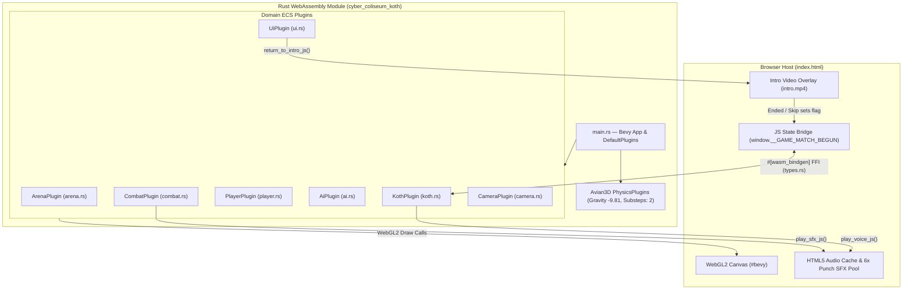
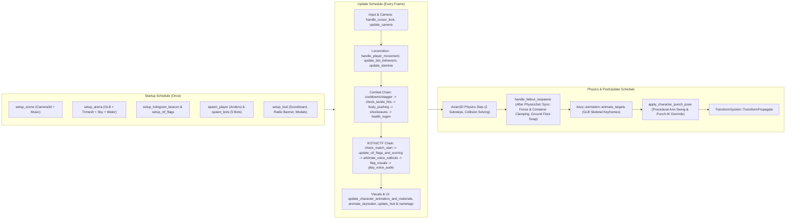
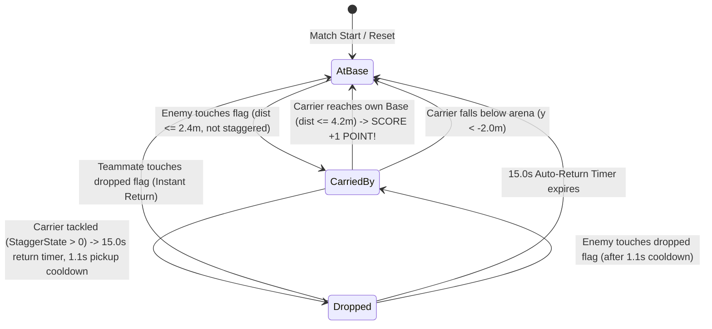
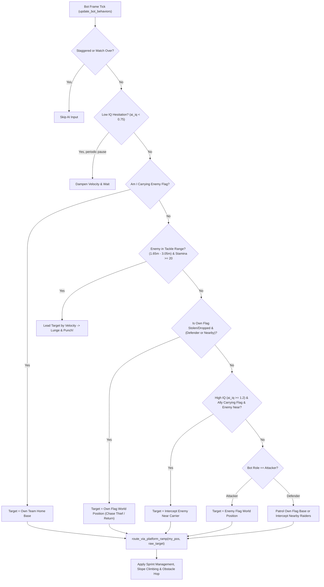
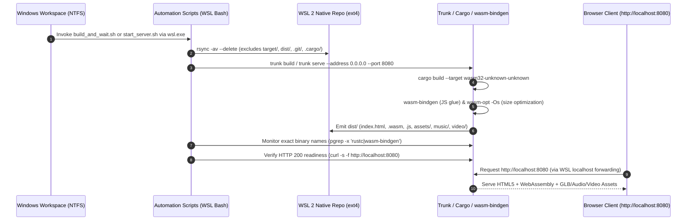

# Cyber-Athletic Coliseum — Game Overview, ECS Architecture & Build/Runtime Pipeline

> **Presentation Master Document**  
> Format-agnostic slide deck foundation (ready for conversion to Slidev, Marp, Reveal.js, PowerPoint, or Google Slides).  
> Horizontal rules (`---`) denote natural slide or section boundaries.

---

## Slide 1: Title & Executive Overview

# Cyber-Athletic Coliseum
### 3v3 Post-Apocalyptic Capture the Flag / King of the Hill in Rust, Bevy 0.15 & WebAssembly

* **Genre:** Fast-paced 3rd-Person / Tactical Isometric 3v3 Arena Sports & Brawler
* **Core Objective:** Capture the enemy flag from their elevated platform and return it to your team's base (**First to 5 captures** or highest score when the **07:42** match clock expires).
* **Technology Stack:**
  * **Engine:** [Bevy 0.15.3](file:///c:/Users/ErlendHeggelund/Documents/antigravity/fervent-curie/Cargo.toml#L7) (Data-Oriented Entity Component System in Rust)
  * **Physics:** [Avian3D 0.2.1](file:///c:/Users/ErlendHeggelund/Documents/antigravity/fervent-curie/Cargo.toml#L8) (3D ECS rigid-body physics at 9.81 m/s² with 2 substeps)
  * **Target Runtime:** Browser-native **WebAssembly (`wasm32-unknown-unknown`) + WebGL2 + HTML5 Audio/Video Bridge**
  * **Bundler & Dev Server:** [Trunk](file:///c:/Users/ErlendHeggelund/Documents/antigravity/fervent-curie/Trunk.toml) with `wasm-bindgen` and `wasm-opt`

---

## Slide 2: Gameplay, Teams & Arena Layout

### The Delta Sector Compound (`60m × 42m` Playable Arena)

| Zone / Team | Coordinates & Elevation | Squad Roster & Roles |
| :--- | :--- | :--- |
| **Blue Team (West Platform)** | `(-20.2, 2.55, 1.8)` — Elevated `2.55m` deck with North/South access ramps | **Anders** (Human Player)<br>**Morten** (AI Attacker)<br>**Jonas** (AI Defender) |
| **Central Courtyard & Canal** | `(0.0, 0.1, 0.0)` — Ruined courtyard, shipping containers, and `-2.2m` sewer trench | Holographic central zone ring, pouring sewer waterfall, and tactical choke points |
| **Red Team (East Platform)** | `(19.5, 2.55, 1.8)` — Elevated `2.55m` deck with West ramp & South staircase | **Siri** (AI Attacker)<br>**Lisa** (AI Attacker)<br>**Per** (AI Defender) |

### Core Mechanics
* **Movement & Stamina:** `WASD` movement (`8.8 m/s`), `Shift` sprint (`1.55×` multiplier draining stamina), and `0.90×` flag-carrier speed penalty.
* **Punch / Shove Lunge (`Space` / `LMB` / `F`):** Consumes `20` stamina (`1.15s` cooldown), features magnetic target assist within a `7.0m` front cone, imparts `17.2 m/s` knockback impulse + upward lift, spawns a 3D kinetic `ShoveShockwave` torus, and forces flag carriers to drop the flag (`StaggerState`).
* **Real-Time Live Tunables (`ESC` Pause → Settings):** Player & bot speed (`SLOW` to `HYPER`), punching power (`LIGHT` to `MEGA LAUNCH`), and AI intelligence (`ROOKIE` to `MASTERMIND`).

---

## Slide 3: High-Level System Architecture

### Dual-Layer Runtime: HTML5/JS Host + Bevy/Wasm Engine

The application runs as a hybrid browser client where [`index.html`](file:///c:/Users/ErlendHeggelund/Documents/antigravity/fervent-curie/index.html) manages the cinematic intro video, DOM overlays, and low-latency HTML5 audio pools, while the compiled Rust WebAssembly binary drives the 3D WebGL2 canvas and ECS simulation.



---

## Slide 4: Codebase Module & Plugin Breakdown

Every domain in [`src/`](file:///c:/Users/ErlendHeggelund/Documents/antigravity/fervent-curie/src/main.rs#L1-L10) is encapsulated as a dedicated Bevy `Plugin`:

| Module | Primary Plugin / Types | Key Responsibilities |
| :--- | :--- | :--- |
| [`src/main.rs`](file:///c:/Users/ErlendHeggelund/Documents/antigravity/fervent-curie/src/main.rs) | `main()`, [`BackgroundMusic`](file:///c:/Users/ErlendHeggelund/Documents/antigravity/fervent-curie/src/main.rs#L16) | Initializes `DefaultPlugins`, WebGL2 window (`#bevy`), `PhysicsPlugins`, domain plugins, and background soundtrack (`Breach_at_Sector_Nine.mp3`). |
| [`src/types.rs`](file:///c:/Users/ErlendHeggelund/Documents/antigravity/fervent-curie/src/types.rs) | [`GameLayer`](file:///c:/Users/ErlendHeggelund/Documents/antigravity/fervent-curie/src/types.rs#L5), [`PauseState`](file:///c:/Users/ErlendHeggelund/Documents/antigravity/fervent-curie/src/types.rs#L14), [`Character`](file:///c:/Users/ErlendHeggelund/Documents/antigravity/fervent-curie/src/types.rs#L224), [`VoiceCallout`](file:///c:/Users/ErlendHeggelund/Documents/antigravity/fervent-curie/src/types.rs#L293) | Shared ECS components (`Health`, `Stamina`, `TackleAbility`, `StaggerState`), physics collision layers, settings multipliers, and `#[wasm_bindgen]` JS audio/intro FFI. |
| [`src/arena.rs`](file:///c:/Users/ErlendHeggelund/Documents/antigravity/fervent-curie/src/arena.rs) | [`ArenaPlugin`](file:///c:/Users/ErlendHeggelund/Documents/antigravity/fervent-curie/src/arena.rs#L13) | Spawns `post_apocalyptic_battlefield.glb`, invisible `0.5m` trimesh & container colliders, angled perimeter barriers, 360° scrolling storm sky domes, and procedural waterfall/trench meshes. |
| [`src/terrain_heights.rs`](file:///c:/Users/ErlendHeggelund/Documents/antigravity/fervent-curie/src/terrain_heights.rs) | [`sample_terrain_height()`](file:///c:/Users/ErlendHeggelund/Documents/antigravity/fervent-curie/src/terrain_heights.rs#L868), `TERRAIN_HEIGHTS` | Pre-extracted `121 × 85` (`10,285` vertices) heightfield grid enabling $O(1)$ bilinear ground height lookups instead of expensive per-frame trimesh raycasts. |
| [`src/player.rs`](file:///c:/Users/ErlendHeggelund/Documents/antigravity/fervent-curie/src/player.rs) | [`PlayerPlugin`](file:///c:/Users/ErlendHeggelund/Documents/antigravity/fervent-curie/src/player.rs#L55), [`CharacterBones`](file:///c:/Users/ErlendHeggelund/Documents/antigravity/fervent-curie/src/player.rs#L41) | Spawns Anders (`main_player.glb`), handles `WASD` movement, slope climbing, magnetic punch lunges, GLB animation blending, and procedural `PostUpdate` bone posing. |
| [`src/ai.rs`](file:///c:/Users/ErlendHeggelund/Documents/antigravity/fervent-curie/src/ai.rs) | [`AiPlugin`](file:///c:/Users/ErlendHeggelund/Documents/antigravity/fervent-curie/src/ai.rs#L21), [`Bot`](file:///c:/Users/ErlendHeggelund/Documents/antigravity/fervent-curie/src/ai.rs#L15) | Spawns 5 rigged GLB bots (Morten, Jonas, Siri, Lisa, Per) and runs IQ-scaled CTF decision making, predictive target leading, and ramp/staircase waypoint routing. |
| [`src/combat.rs`](file:///c:/Users/ErlendHeggelund/Documents/antigravity/fervent-curie/src/combat.rs) | [`CombatPlugin`](file:///c:/Users/ErlendHeggelund/Documents/antigravity/fervent-curie/src/combat.rs#L25), [`ShoveShockwave`](file:///c:/Users/ErlendHeggelund/Documents/antigravity/fervent-curie/src/combat.rs#L17) | Evaluates `165°` front shove hit arcs (`3.1m` range), knockback impulses, perimeter deflection, continuous body-to-body shoulder pushing, and shockwave torus animations. |
| [`src/koth.rs`](file:///c:/Users/ErlendHeggelund/Documents/antigravity/fervent-curie/src/koth.rs) | [`KothPlugin`](file:///c:/Users/ErlendHeggelund/Documents/antigravity/fervent-curie/src/koth.rs#L131), [`KothManager`](file:///c:/Users/ErlendHeggelund/Documents/antigravity/fervent-curie/src/koth.rs#L40), [`TeamFlag`](file:///c:/Users/ErlendHeggelund/Documents/antigravity/fervent-curie/src/koth.rs#L30) | Manages CTF flag state machines, scoring, match countdown timer, cloth banner wind animation, and priority-based voice callout arbitration. |
| [`src/camera.rs`](file:///c:/Users/ErlendHeggelund/Documents/antigravity/fervent-curie/src/camera.rs) | [`CameraPlugin`](file:///c:/Users/ErlendHeggelund/Documents/antigravity/fervent-curie/src/camera.rs#L82), [`OrbitCamera`](file:///c:/Users/ErlendHeggelund/Documents/antigravity/fervent-curie/src/camera.rs#L19) | Dual-mode camera (`ThirdPersonAction` & `TacticalIsometric`) with obstacle spring-arm raycasting, fence clamping, wall-compression look-down lift, and ledge clearance. |
| [`src/ui.rs`](file:///c:/Users/ErlendHeggelund/Documents/antigravity/fervent-curie/src/ui.rs) | [`UiPlugin`](file:///c:/Users/ErlendHeggelund/Documents/antigravity/fervent-curie/src/ui.rs#L105) | Renders top scoreboard HUD, radio callout banners, 3D-to-2D projected character nametags with HP/Stamina bars, and Pause / Settings / Exit modal dialogs. |

---

## Slide 5: Frame Execution Pipeline (Bevy Schedules)

How systems execute deterministically during each frame across `Startup`, `Update`, `PhysicsSchedule`, and `PostUpdate`:



---

## Slide 6: Deep Dive — Capture the Flag & Voice Arbitration State Machines

### 1. CTF Flag Lifecycle ([`src/koth.rs`](file:///c:/Users/ErlendHeggelund/Documents/antigravity/fervent-curie/src/koth.rs#L18-L27))

Each team's [`TeamFlag`](file:///c:/Users/ErlendHeggelund/Documents/antigravity/fervent-curie/src/koth.rs#L30) transitions between three states (`AtBase`, `CarriedBy(Entity)`, and `Dropped`) based on proximity, stagger knockdowns, and base capture radii:



### 2. Priority-Driven Radio Voice Arbitrator ([`arbitrate_voice_callouts`](file:///c:/Users/ErlendHeggelund/Documents/antigravity/fervent-curie/src/koth.rs#L801))
To prevent audio overlapping when 6 characters fight simultaneously, candidate [`VoiceCallout`](file:///c:/Users/ErlendHeggelund/Documents/antigravity/fervent-curie/src/types.rs#L293) events are collected each frame and filtered by cooldowns and a 5-tier [`VoicePriority`](file:///c:/Users/ErlendHeggelund/Documents/antigravity/fervent-curie/src/types.rs#L280) hierarchy:
1. `MatchVictory` (Priority 5) — Always preempts active speech.
2. `FlagCapture` (Priority 4) — Scoring a point (`captured_flag.mp3`).
3. `FlagEvent` (Priority 3) — Flag stolen, dropped, touch-returned, or auto-returned.
4. `TacticalComms` (Priority 2) — Match start, escort carrier, or stolen flag alerts.
5. `CombatBark` (Priority 1) — Tackle hit reactions (only triggered when the human player is involved or within `14m`).

---

## Slide 7: Deep Dive — Hybrid Physics, Terrain & Procedural Animation

### 1. Zero-Raycast Bilinear Terrain Heightfield + Avian3D Colliders
* **Visual Fidelity:** [`post_apocalyptic_battlefield.glb`](file:///c:/Users/ErlendHeggelund/Documents/antigravity/fervent-curie/src/arena.rs#L164) is rendered untouched while all physics colliders remain invisible.
* **Fast Ground Queries:** Instead of firing 60+ raycasts per second into a 20,160-triangle mesh, [`sample_terrain_height(x, z)`](file:///c:/Users/ErlendHeggelund/Documents/antigravity/fervent-curie/src/terrain_heights.rs#L868) performs an $O(1)$ bilinear interpolation over a pre-extracted `0.5m` grid (`121 × 85` points).
* **Smooth Ramp & Stair Climbing:** Characters sample terrain height `0.48m` ahead along their velocity vector and smoothly adjust vertical velocity (`climb_vy`) so capsule colliders glide up stairs and ramps without snagging.
* **Post-Physics Safety Clamping:** [`handle_fallout_respawns`](file:///c:/Users/ErlendHeggelund/Documents/antigravity/fervent-curie/src/arena.rs#L549) runs in `PostUpdate` after `PhysicsSet::Sync` to enforce perspective-angled perimeter fence boundaries (`playable_min_x(z)`, `playable_max_x(z)`), eject characters from hollow shipping containers, and prevent ground clipping.

### 2. Two-Stage Skeletal + Procedural Bone Animation ([`src/player.rs`](file:///c:/Users/ErlendHeggelund/Documents/antigravity/fervent-curie/src/player.rs#L619))
* **Stage 1 (`Update`):** Crossfades embedded GLB `Idle` and `Run` skeletal animations (`180ms` transition) with playback speed scaled to horizontal velocity.
* **Stage 2 (`PostUpdate`):** [`apply_character_punch_pose`](file:///c:/Users/ErlendHeggelund/Documents/antigravity/fervent-curie/src/player.rs#L619) caches Mixamo bone entities (`CharacterBones`) and overrides upper-body transforms in model space **after** `animate_targets` and **before** `TransformPropagate` to deliver:
  * Contralateral bent-elbow running arm swing synchronized with leg stride phase.
  * Dynamic right-cross punch extension + left guard retraction during `punch_anim_timer`.

---

## Slide 8: Deep Dive — Bot AI Decision Architecture

Each of the 5 AI bots ([`src/ai.rs`](file:///c:/Users/ErlendHeggelund/Documents/antigravity/fervent-curie/src/ai.rs)) evaluates a real-time priority tree modulated by the live **AI Intelligence multiplier (`ai_iq`)**:



---

## Slide 9: Compilation & Runtime Architecture (Windows ↔ WSL 2 ↔ Browser)

### Why Cross-Filesystem Compilation Matters
Editing takes place in the Windows workspace (`c:\Users\ErlendHeggelund\Documents\antigravity\fervent-curie`), while Rust/Wasm compilation runs inside **native WSL 2 (`ext4`)** (`~/repos/cyber_coliseum_koth` with `CARGO_TARGET_DIR=~/cargo_target`) to avoid Windows NTFS/9P mount I/O bottlenecks and file locking.



### Compiler Optimization Profiles ([`Cargo.toml`](file:///c:/Users/ErlendHeggelund/Documents/antigravity/fervent-curie/Cargo.toml#L16-L25))
* **Dev Profile (`[profile.dev]`):** `opt-level = 1` for crate code + `opt-level = 3` for all dependencies (`[profile.dev.package."*"]`), ensuring 60 FPS physics and rendering even in debug builds.
* **Release Profile (`[profile.release]`):** `opt-level = "s"` (size optimization), `lto = "thin"`, and `data-wasm-opt="s"` in [`index.html`](file:///c:/Users/ErlendHeggelund/Documents/antigravity/fervent-curie/index.html#L146) for compact WebAssembly payloads.

---

## Slide 10: How to Compile, Run & Monitor the Game

### 1. Automated Build & Server Skills
The repository includes two turnkey automation skills under [`.agents/skills/`](file:///c:/Users/ErlendHeggelund/Documents/antigravity/fervent-curie/.agents/skills/game-start-server/SKILL.md):

* **Start or Restart Persistent Dev Server ([`start_server.sh`](file:///c:/Users/ErlendHeggelund/Documents/antigravity/fervent-curie/.agents/skills/game-start-server/scripts/start_server.sh)):**
  ```powershell
  # Foreground daemon mode (keeps WSL 2 VM alive in background tasks)
  wsl.exe -e bash /mnt/c/Users/ErlendHeggelund/Documents/antigravity/fervent-curie/.agents/skills/game-start-server/scripts/start_server.sh daemon

  # Check server health & recent logs
  wsl.exe -e bash /mnt/c/Users/ErlendHeggelund/Documents/antigravity/fervent-curie/.agents/skills/game-start-server/scripts/start_server.sh status
  ```
* **Sync & Compile Synchronous Builds ([`build_and_wait.sh`](file:///c:/Users/ErlendHeggelund/Documents/antigravity/fervent-curie/.agents/skills/game-compile-and-wait/scripts/build_and_wait.sh)):**
  ```powershell
  # Standard development build
  wsl.exe -e bash /mnt/c/Users/ErlendHeggelund/Documents/antigravity/fervent-curie/.agents/skills/game-compile-and-wait/scripts/build_and_wait.sh build

  # Production release build (thin LTO + size-optimized Wasm)
  wsl.exe -e bash /mnt/c/Users/ErlendHeggelund/Documents/antigravity/fervent-curie/.agents/skills/game-compile-and-wait/scripts/build_and_wait.sh release
  ```

### 2. Engineering Safeguards ([`BUILD_MONITORING_MEMO.md`](file:///c:/Users/ErlendHeggelund/Documents/antigravity/fervent-curie/BUILD_MONITORING_MEMO.md))
* **WSL 2 Daemon Persistence:** WSL 2 terminates background `nohup` processes when the last interactive `wsl.exe` session closes; running `start_server.sh daemon` keeps the session anchored.
* **Zero Self-Matching Process Traps:** Build watchers strictly use exact executable matching (`pgrep -x 'rustc|wasm-bindgen'`) and HTTP health checks (`curl -s -f http://localhost:8080`) instead of `pgrep -f`, preventing subshell command-line self-matching infinite loops.
